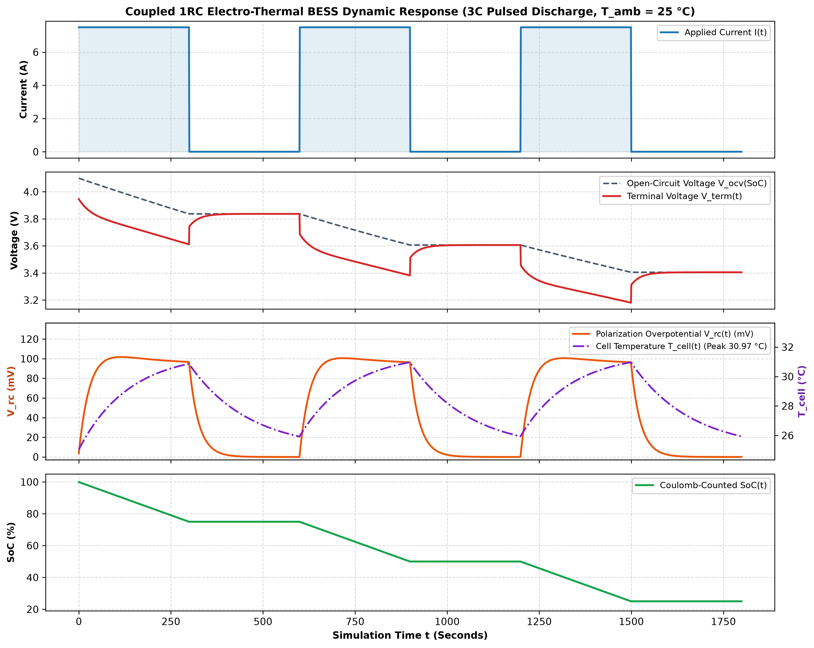
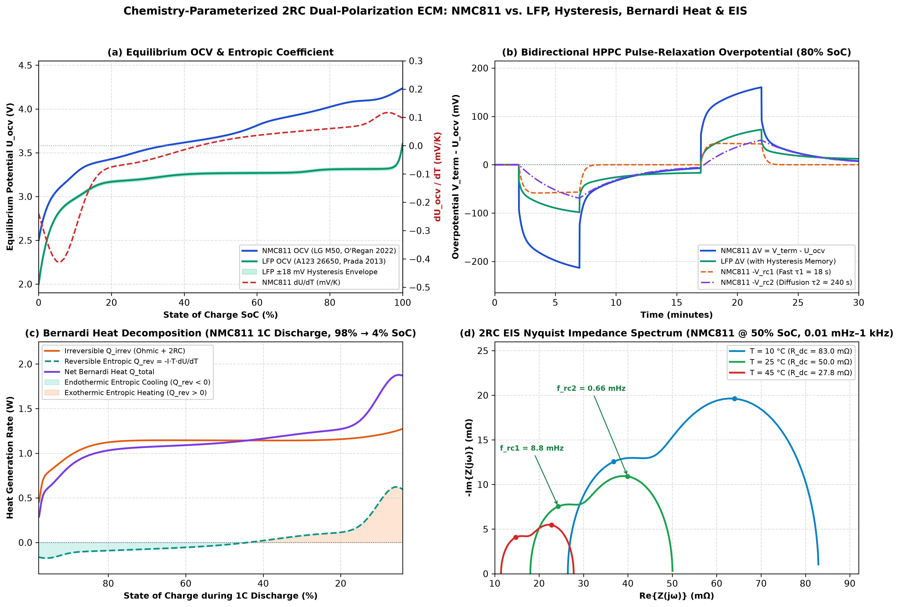

# Battery Energy Storage System (BESS) SoC & Dynamics Solver

[](https://github.com/hariszafar740-lang/bess-soc-dynamics-solver/actions/workflows/ci.yml)

[](LICENSE)


Python engine implementing both a baseline **1RC Thevenin Equivalent Circuit Model (ECM)** and a **chemistry-parameterized 2RC dual-polarization ECM (`NMC811` & `LFP`)** with **monotone PCHIP open-circuit potential splines**, **Plett one-state voltage hysteresis**, **Bernardi reversible entropic + irreversible Joule/polarization heat balances**, **Electrochemical Impedance Spectroscopy (`EIS`) Nyquist synthesis**, and **Arrhenius sensitivity sweeps**.

> **Scope and validation status.** Equilibrium open-circuit voltage (`OCV`) and entropic (`dU/dT`) lookup tables in `src/cell_chemistry.py` are extracted at 1% SoC resolution from published electrode parameterizations in `PyBaMM 26.10.1.1` (`O'Regan et al., 2022` for LG M50 NMC811; `Prada et al., 2013` for A123 26650 LFP) and verified in CI (`tests/test_pybamm_crosscheck.py`). Dynamic 2RC resistances, capacitances, hysteresis scales, and lumped convective coefficients remain representative single-cell engineering values rather than pack-level or safety-certified manufacturer specifications.

## Repository layout

| Path | Contents |
|---|---|
| `src/bess_model.py` | `LiIonBatteryModel` – baseline 1RC ECM, OCV polynomial, Coulomb counting, Arrhenius scaling |
| `src/cell_chemistry.py` | `ChemistrySpec`, `MonotonePCHIP`, SHA-256-pinned `NMC811_LG_M50_5AH` (`ORegan2022`) & `LFP_A123_ANR26650_2P3AH` (`Prada2013`) records |
| `src/ecm_2rc.py` | `TwoRCBatteryModel` – exact 2RC integration, Plett hysteresis, First-Law Bernardi heat balance, `compute_eis_nyquist` |
| `src/thermal_model.py` | `ThermalBESSModel`, `arrhenius_factor`, shared reference constants and temperature envelope |
| `src/sensitivity_analysis.py` | `run_thermal_sensitivity_sweep`, `SimulationError` |
| `src/profile_generator.py` | Pulsed and deterministic grid load profiles |
| `src/visualizer.py` | 4-panel 1RC dynamic plot and 4-panel 2RC multi-chemistry/EIS diagnostic figure |
| `main.py` | Regenerates `results/*.png` figures and prints the electro-thermal & 2RC chemistry benchmarks |
| `tests/` | Hermetic regression, First-Law conservation, EIS, and `PyBaMM 26.10.1.1` cross-check suite |

## Model equations

Sign convention: **I > 0 is discharge, I < 0 is charge.** Units are SI throughout (A, V, Ω, F, s, J, W, K) except where a name ends in `_c` (°C) or the sweep's inputs, which are documented below.

### 1. Terminal voltage
$$V_{term}(t) = V_{ocv}(SoC) - I(t)\,R_0(T) - V_{rc}(t)$$

### 2. RC polarization (exact integration)
$$\frac{dV_{rc}}{dt} = \frac{I}{C_1} - \frac{V_{rc}}{R_1(T)\,C_1}, \qquad \tau_1 = R_1(T)\,C_1$$

For a constant current over one step of length $\Delta t$ the model uses the exact solution
$$V_{rc}(t+\Delta t) = V_{rc}(t)\,e^{-\Delta t/\tau_1} + I\,R_1\left(1-e^{-\Delta t/\tau_1}\right)$$
which is unconditionally stable. (The earlier explicit-Euler update was unstable when $\Delta t > 2\tau_1$; a test reproduces this case.)

### 3. Coulomb-counting SoC
$$SoC(t+\Delta t) = \text{clip}_{[0,1]}\!\left(SoC(t) - \frac{I\,\Delta t}{Q_{nominal}}\right), \qquad Q_{nominal} = 3600\cdot C_{Ah}$$
If the clip is active, a `RuntimeWarning` is emitted so that un-stored or un-delivered charge is not silent.

### 4. Open-circuit voltage
An empirical 4th-order polynomial in SoC: $V_{ocv}(s) = 3.2 + 0.9s - 0.5s^2 + 0.8s^3 - 0.3s^4$ (3.20 V at SoC 0, 4.10 V at SoC 1). It is a generic shape, **not fitted to any cell chemistry**, and has **no temperature dependence**.

### 5. Temperature-dependent parameters
Resistances follow Arrhenius scaling relative to a fixed reference:
$$R_i(T) = R_{i,ref}\,\exp\!\left[\frac{E_a}{R_g}\left(\frac{1}{T} - \frac{1}{T_{ref}}\right)\right], \quad i \in \{0, 1\}$$
$$C_1(T) = C_{1,ref}\ \text{(held constant)}, \qquad \tau_1(T) = R_1(T)\,C_1$$

| Quantity | Value | Unit | Note |
|---|---|---|---|
| $T_{ref}$ | 298.15 | K | 25 °C; reference for all `*_ref` values |
| $R_{0,ref}$ | 0.02 | Ω | Default; caller-supplied |
| $R_{1,ref}$ | 0.015 | Ω | Default; caller-supplied |
| $C_{1,ref}$ | 2000 | F | Default; τ₁ = 30 s at reference |
| $E_a$ | 20 000 | J/mol | **Assumed**, not fitted to data |
| $R_g$ | 8.314 | J/(mol·K) | |
| Supported $T$ | 253.15 – 333.15 | K | −20 °C to +60 °C; outside raises `ValueError` |

**Correct usage (the fix):** `LiIonBatteryModel.set_temperature(T_K)` always computes the active `R0`, `R1` from the *reference* values (`r0_ref`, `r1_ref`), so the result depends only on the current temperature, not on history. `tau1` is a property (`R1*C1`) and cannot go stale. Active parameters are read-only; assigning to `r0`, `r1`, `c1`, or `tau1` raises `AttributeError`. `reset()` restores the reference temperature.

### 6. Lumped thermal balance
$$m\,C_p\,\frac{dT}{dt} = I^2\,\bigl(R_0(T)+R_1(T)\bigr) - h_A\,(T - T_{amb})$$

- Joule heat uses $I^2(R_0+R_1)$. For constant-sign current $|V_{rc}| \le |I|R_1$, so the true transient dissipation $V_{rc}^2/R_1$ never exceeds this term: it is a **conservative upper bound** on polarization heat.
- Entropic (reversible) heat is **not modelled**: no entropy data is available.
- Default parameters: $m = 0.045$ kg, $C_p = 900$ J/(kg·K), $h_A = 0.25$ W/K, so $\tau_{th} = m C_p/h_A = 162$ s, and a steady-state rise of $I^2(R_0+R_1)/h_A$.
- Integration: with the heat source held constant over a step, the exact solution is
  $T(t+\Delta t) = T_{eq} + (T(t) - T_{eq})\,e^{-h_A\Delta t/(mC_p)}$, $T_{eq} = T_{amb} + Q/h_A$. The source is evaluated at the start-of-step temperature (explicit coupling). Adiabatic cells ($h_A = 0$) are supported.

## Numerical behaviour and limitations

- **Stability:** RC and thermal updates are exact for piecewise-constant input and remain bounded for any $\Delta t > 0$. Accuracy of the R(T)–heat coupling is first order in $\Delta t$: in the sweep, going from $\Delta t = 1$ s to $0.1$ s changes peak temperature by less than 3 mK and minimum voltage by less than 30 µV.
- **Invalid inputs are rejected**, not clipped: non-finite values, SoC outside [0, 1], $\Delta t \le 0$, non-positive capacity, $C_1$, or $R_1$, negative $R_0$, and temperatures outside the supported envelope all raise `ValueError`. Non-finite results raise `FloatingPointError`.
- **SoC bounds** are physical limits, enforced by clipping with a `RuntimeWarning`.
- **Sweep diagnostics:** `run_thermal_sensitivity_sweep` raises `SimulationError` if any case produces a non-finite state or drives the cell outside the −20 to +60 °C envelope. It never returns corrupted numbers.
- **Not modelled:** OCV temperature coefficient, hysteresis, self-discharge, aging/capacity fade, cell-to-cell variation, spatial (radial/axial) temperature gradients, entropic heat, current-dependent $C_1$ or $R$, and any thermal-runaway chemistry.

## Default sensitivity sweep

`python main.py` runs ambient ∈ {10, 25, 40, 50} °C × C-rate ∈ {1, 2, 3, 4} with a 1800 s pulsed discharge (300 s on / 300 s off, $\Delta t$ = 1 s, starting at SoC 1 and at ambient temperature). Output at the time of this change:

| Ambient (°C) | C-rate | Min V_term (V) | Peak Temp (°C) |
|---|---|---|---|
| 10 | 1 | 3.707 | 11.13 |
| 10 | 4 | 2.833 | 23.40 |
| 25 | 1 | 3.751 | 25.74 |
| 25 | 4 | 2.928 | 34.77 |
| 50 | 1 | 3.790 | 50.40 |
| 50 | 4 | 3.035 | 55.82 |

The full 16-row table is printed by `main.py`. These numbers come from this model and its assumed parameters. They are not measured data.

## Engineering validation

Checks performed (all automated in `tests/`):

1. **Closed-form RC response:** constant-current $V_{rc}(t)$ equals $IR_1(1-e^{-t/\tau_1})$ to 1e-12 over 1800 steps.
2. **Closed-form thermal step:** a single exact step at $\Delta t = 400$ s (beyond $\tau_{th}$) matches the analytic expression to 1e-12 K. Steady state under constant current converges to $T_{amb} + I^2(R_0+R_1)/h_A$ to 1e-9 K. Adiabatic heating matches $Q\Delta t/(mC_p)$.
3. **Coulomb counting:** 2.5 A for 1800 s from full charge leaves SoC 0.50.
4. **Physical bound on sweep peak temperature:** $T_{peak} \le T_{amb} + I^2(R_0+R_1)(T_{amb})/h_A$, because Arrhenius resistance is non-increasing in T above ambient. At 10 °C / 1C the bound is 11.34 °C and the computed peak is 11.13 °C.
5. **Ordering checks:** colder cells have lower minimum voltage; higher C-rate gives lower minimum voltage and higher peak temperature; forward and reverse sweep orders and repeated runs are bit-identical.
6. **Step-size convergence:** $\Delta t$ = 1 s vs 0.1 s, as above.

**Not validated:** agreement with measured cell discharge curves, pulse-power tests, thermal chamber data, or any manufacturer datasheet. No such data is included in this repository. Parameters ($R_0$, $R_1$, $C_1$, $E_a$, $m$, $C_p$, $h_A$, OCV polynomial) are generic defaults and should be replaced with characterised values (HPPC/EIS for $R$, $C_1$; calorimetry for $m C_p$ and $h_A$; temperature-dependent OCV for entropic effects) before any quantitative use.

## Previously reported defects (reproduced and fixed)

| Defect | Reproduction on original code | Root cause | Fix / regression test |
|---|---|---|---|
| Extreme sweep output at 10 °C / 1C | min V = **−3.0753e18 V**, peak T = **3.3221e17 °C** | `sensitivity_analysis.py` rescaled `battery.r0/r1` by Arrhenius from their **already-scaled** values every step (×≈1.53 per step at 10 °C), so R grew exponentially and the thermal/electrical states diverged | Reference-based `set_temperature`; sweep no longer writes into the model's parameters. `test_regression_10c_1c_sweep_is_finite_and_physical`, `test_peak_temperature_respects_analytic_upper_bound_at_10c_1c` |
| Stale RC time constant | `tau1` stayed at 30 s after `r1` changed to 0.03 Ω (should be 60 s) | `tau1` was computed once in `__init__` | `tau1` is a derived property. `test_rc_time_constant_tracks_resistance_changes` |
| Silent RC instability | With $\tau_1 = 1\,\mu$s and $\Delta t = 1$ s, $V_{rc}$ alternated and grew to $10^{32}$ V within 6 steps | Explicit Euler for a stiff RC | Exact exponential integration. `test_rc_step_is_stable_when_dt_exceeds_twice_tau` |
| Silent thermal oscillation | With $\Delta t = 400$ s (> $\tau_{th}$), temperature swung between 247 K and 357 K | Explicit Euler for the thermal balance | Exact step with frozen heat source. `test_large_time_step_is_stable_and_monotone_toward_equilibrium` |
| Invalid SoC accepted | `step(soc=1.2)` returned 1.0, `get_ocv(1.5)` returned 4.10 V | Silent clipping of inputs | Input validation raises `ValueError`. `test_invalid_initial_soc_is_rejected`, `test_get_ocv_rejects_out_of_domain_soc` |
| Global RNG side effect | `dynamic_grid_step` reseeded NumPy's global RNG | `np.random.seed(42)` inside the generator | Local `RandomState(42)` (identical output). `test_grid_profile_is_deterministic_and_does_not_reseed_global_rng` |

## Installation

Requires Python 3.10 or newer (GitHub Actions CI verifies Python 3.10, 3.11, 3.12, and 3.13).

```bash
python -m venv bess_env
source bess_env/bin/activate
pip install -r requirements-dev.txt
```

Runtime-only install: `pip install -r requirements.txt`.

## Running the tests and checks

```bash
pytest                 # runs tests/ (pytest.ini sets testpaths and pythonpath)
ruff check .           # lint gate: E4, E7, E9, F (see ruff.toml)
python main.py         # default sensitivity sweep; exits non-zero if a case fails
```

`pytest.ini` puts the repository root on `PYTHONPATH`, so no manual environment variable is needed. The tests write nothing to the repository (the plot test uses `tmp_path`).

Test modules:

- `tests/test_bess_model.py`: OCV, Coulomb counting, closed-form RC, reference-parameter immutability, Arrhenius from reference (forward/reverse orders), `tau1` consistency, reset, temperature envelope, parameter limits, SoC clipping warning, invalid-input rejection.
- `tests/test_thermal_model.py`: Arrhenius factor properties and closed form, closed-form thermal steps, steady state, stiff-step stability, adiabatic limit, sign independence, input validation.
- `tests/test_sensitivity_analysis.py`: reported 10 °C / 1C regression, analytic peak-temperature bound, trend and ordering checks, repeated-run identity, runaway diagnostic (`SimulationError`), shared-instance history independence.
- `tests/test_profile_generator.py`: pulse duty cycle, grid determinism, global-RNG isolation.
- `tests/test_visualizer.py`: plot file is produced.

Note on evidence: the new test modules import the new API (`set_temperature`, `SimulationError`, `arrhenius_factor`). They cannot be run against the original source, so the original defects were demonstrated by direct reproduction scripts rather than by these tests failing on the old code.

## Reproducible Dynamic Simulation Artifact

Running `python main.py` deterministically executes a coupled electro-thermal `3C` (`7.5 A` on `2.5 Ah`, `300 s` discharge / `300 s` rest, `T_amb = 25 °C`, `dt = 1.0 s`, `1800 s`) trajectory and exports `results/bess_dynamic_response.png` (`Min V_term = 3.181 V`, `Peak T_cell = 30.97 °C`, `Final SoC = 25.0%`):



## Multi-Chemistry 2RC Dual-Polarization, Hysteresis, Bernardi Heat & EIS (`Module 2`)

`src/cell_chemistry.py` and `src/ecm_2rc.py` extend the solver to a 5-state coupled electro-thermal system $x = [SoC,\; V_{rc,1},\; V_{rc,2},\; h,\; T_{cell}]$:

$$V_{term}(t) = U_{ocv,ref}(SoC) + (T_{cell} - T_{ref})\frac{\partial U_{ocv}}{\partial T}(SoC) + M_h\,h(t) - I\,R_0(SoC, T_{cell}) - V_{rc,1}(t) - V_{rc,2}(t)$$

$$m\,c_p\frac{dT_{cell}}{dt} = \underbrace{I^2 R_0 + \frac{1}{\Delta t}\sum_{k=1}^{2}\int_0^{\Delta t}\frac{V_{rc,k}(s)^2}{R_k}\,ds + p_{hyst}}_{\bar{Q}_{irrev} \ge 0} \;\underbrace{-\; I\,T_{cell}\,\frac{\partial U_{ocv}}{\partial T}(SoC)}_{Q_{rev}} - h_A(T_{cell} - T_{amb})$$

- **Exact First-Law RC energy conservation:** $\int_0^{\Delta t} (V_{rc,k}(s)^2 / R_k)\,ds$ is evaluated analytically via `expm1`-stabilized $\phi_1(x) = (1 - e^{-x})/x$, conserving stored electrostatic energy $\frac{1}{2}C_k V_{rc,k}^2$ to $< 10^{-12}\text{ J}$ across arbitrary $\Delta t$ (`tests/test_ecm_2rc.py`).
- **Published equilibrium potentials:** `NMC811_LG_M50_5AH` (`5.0 Ah`, O'Regan et al., *Electrochimica Acta* 425, 140700, 2022) captures endothermic entropic cooling ($Q_{rev} < 0$) above $\approx 38\%$ SoC and exothermic entropic heating ($Q_{rev} > 0$) at low SoC; `LFP_A123_ANR26650_2P3AH` (`2.3 Ah`, Prada et al., *J. Electrochem. Soc.* 160(4), A616, 2013) captures the flat $\approx 3.27\text{ V}$ two-phase plateau with $\pm 18\text{ mV}$ Plett hysteresis memory.
- **Independent `PyBaMM` cross-validation:** `tests/test_pybamm_crosscheck.py` (`pip install -r requirements-validation.txt`) verifies both 101-point stoichiometric tables against `pybamm==26.10.1.1` to $< 5\,\mu\text{V}$ and dynamic 2RC `Thevenin` voltage/temperature trajectories to $< 0.4\text{ mV}$ and $< 2\text{ mK}$.



## Citation

Machine-readable citation metadata is provided in [`CITATION.cff`](CITATION.cff).
