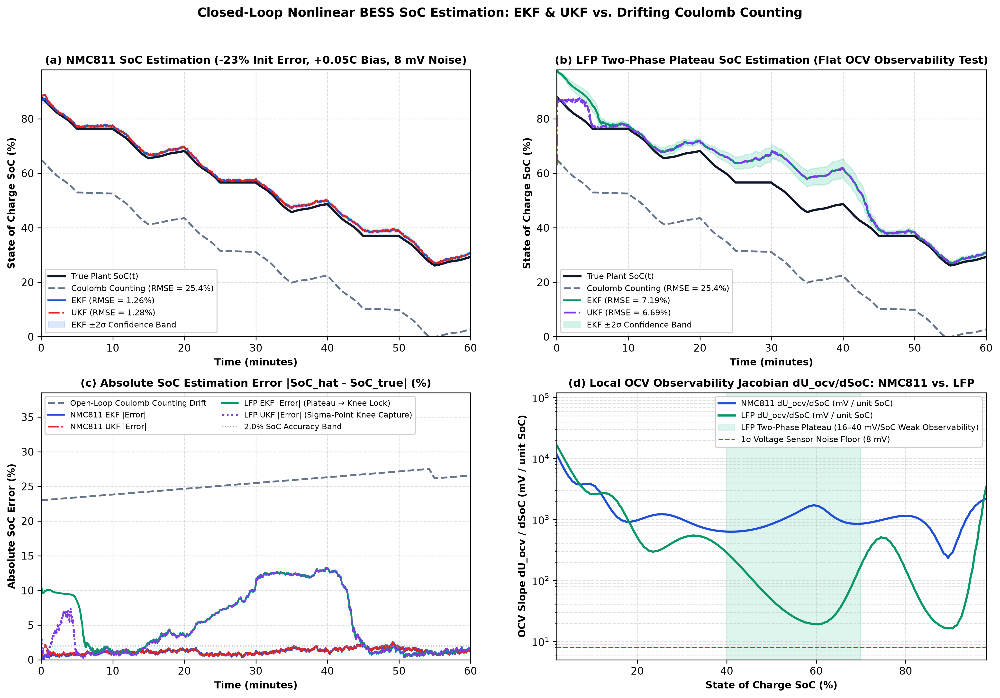
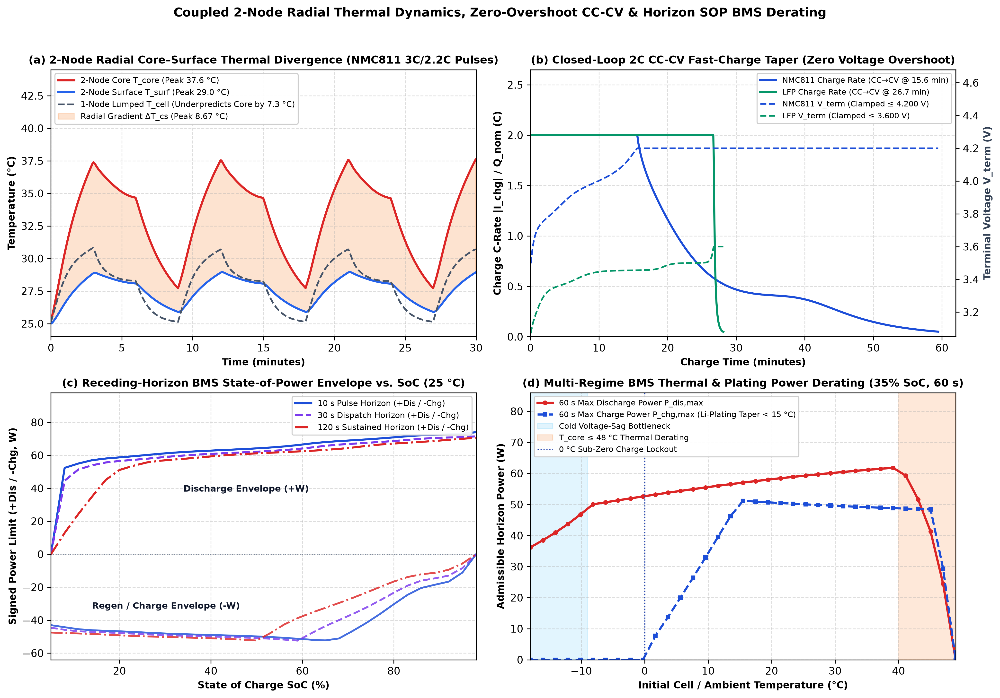
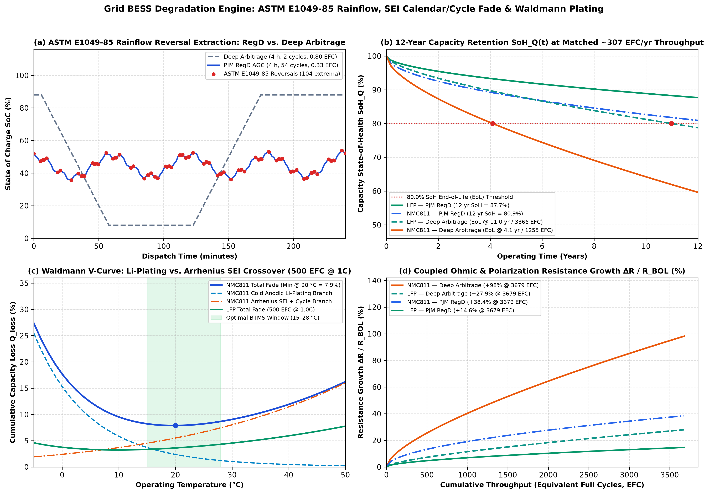

# Battery Energy Storage System (BESS) SoC & Dynamics Solver

[](https://github.com/hariszafar740-lang/bess-soc-dynamics-solver/actions/workflows/ci.yml)
[](https://hariszafar740-lang.github.io/bess-soc-dynamics-solver/)
[](https://github.com/hariszafar740-lang/bess-soc-dynamics-solver/releases/tag/v1.0.0)


[](LICENSE)

> **Live Interactive Browser Workbench (Zero-CDN HTML5/Canvas):**
> **[https://hariszafar740-lang.github.io/bess-soc-dynamics-solver/](https://hariszafar740-lang.github.io/bess-soc-dynamics-solver/)**, interactively sweep `NMC811` vs. `LFP` chemistry, ambient temperature (`-10 °C` to `+50 °C`), C-rate, `EKF` initialization offset, 2-node convective cooling h_sa, receding-horizon `SOP` bottlenecks, `EIS` Nyquist spectra, and 12-year rainflow aging trajectories.

Python engine implementing a baseline **1RC Thevenin Equivalent Circuit Model (ECM)**, a chemistry-parameterized 2RC dual-polarization ECM (`NMC811` & `LFP`) with monotone PCHIP open-circuit potential splines, Plett one-state voltage hysteresis.
Bernardi reversible + irreversible heat balances, EIS Nyquist synthesis, closed-loop `EKF` / `UKF` `SoC` estimators, 2-node radial core–surface thermal & `SOP` BMS derating, and ASTM E1049-85 rainflow + semi-empirical SEI/plating lifetime degradation.

I would read the thermal numbers as model output rather than measurement: the convective coefficient is probably the weakest input, and the Arrhenius fit likely dominates the cold-end error.

> **Scope and validation status.** Equilibrium open-circuit voltage (`OCV`) and entropic (`dU/dT`) lookup tables in `src/cell_chemistry.py` are extracted at 1% SoC resolution from published electrode parameterizations in `PyBaMM 26.10.1.1` (`O'Regan et al., 2022` for LG M50 NMC811; `Prada et al., 2013` for A123 26650 LFP) and verified in CI (`tests/test_pybamm_crosscheck.py`). Dynamic 2RC resistances, capacitances, hysteresis scales, and lumped convective coefficients remain representative single-cell engineering values rather than pack-level or safety-certified manufacturer specifications.

## Quantitative Verification & Benchmark Summary (`v1.0.0`)

| Subsystem / Module | Physical Formulation & Numerical Method | Verified Benchmark Metric |
|:--- |:--- |:--- |
| 1RC Electro-Thermal Baseline | Exact ZOH RC polarization + Arrhenius R(T) + lumped Joule–convective ODE | `3C` pulsed discharge @ `25 °C`: `Min V_term = 3.181 V`, `Peak T_cell = 30.97 °C`, `Final SoC = 25.0%` |
| 2RC Chemistry ECM (`NMC811` & `LFP`) | `PyBaMM 26.10.1.1` PCHIP `OCV` & ∂U/∂T, Plett hysteresis, Bernardi Q_irrev+Q_rev, EIS | `NMC811` R_dc(25/10°C) = 50.0/83.0 mΩ; `1C` Q_rev in [-0.18, +0.62] W |
| Closed-Loop `EKF` & `UKF` Estimators | Analytical 3×3 state/measurement Jacobians, Joseph covariance, 7-point UT, χ^2 NIS gate | `-23%` init offset + `+0.05C` bias: `NMC811` CC/EKF/UKF = `25.4% / 1.26% / 1.28%`; `LFP` = `25.4% / 7.19% / 6.69%` |
| 2-Node Radial Thermal & BMS `SOP` | Exact 2×2 Putzer matrix exponential (T_core, T_surf), implicit `CC-CV`, horizon bisection | `Peak ΔT_core-surf = 8.67 °C`; `2C` `CC->CV` = `15.6 / 26.7 min` (`0.00 V` overshoot); `0 °C` plating charge lockout |
| ASTM E1049-85 Rainflow & Aging | 4-point rainflow stack + virtual-age SEI (t^0.5), Wöhler DoD (β_dod), Waldmann cold Li-plating | `80% DoD` Arbitrage EoL (`NMC811 / LFP`) = `4.1 / 11.0 yr`; `PJM RegD` 12-yr SoH = `80.9% / 87.7%`; `20 °C` V-curve min |

## Repository layout

| Path | Contents |
|---|---|
| `src/bess_model.py` | `LiIonBatteryModel` – baseline 1RC ECM, OCV polynomial, Coulomb counting, Arrhenius scaling |
| `src/cell_chemistry.py` | `ChemistrySpec`, `MonotonePCHIP`, SHA-256-pinned `NMC811_LG_M50_5AH` (`ORegan2022`) & `LFP_A123_ANR26650_2P3AH` (`Prada2013`) records |
| `src/ecm_2rc.py` | `TwoRCBatteryModel` – exact 2RC integration, Plett hysteresis, First-Law Bernardi heat balance, `compute_eis_nyquist` |
| `src/soc_estimators.py` | `CoulombCountingEstimator`, `ExtendedKalmanFilterEstimator` (analytical Jacobians + Joseph update), `UnscentedKalmanFilterEstimator` (7-sigma-point UT + NIS gating) |
| `src/bms_thermal_sop.py` | `TwoNodeThermalNetwork` (exact 2 ×2 Putzer matrix exponential), `CoupledTwoNodeBESS`, `simulate_cc_cv_charge`, `compute_sop_limits` |
| `src/degradation_model.py` | `extract_rainflow_cycles` (ASTM E1049-85 4-point stack), `SemiEmpiricalAgingModel` (virtual-age SEI + Wöhler DoD + Waldmann plating), `simulate_grid_duty_aging` |
| `src/cli.py` / `pyproject.toml` | PEP 621 + PEP 561 typed package (`bess_solver` `v1.0.0`) & 8-subcommand `bess-sim` CLI (`info`, `pulse`, `ecm`, `estimate`, `sop`, `degrade`, `sweep`, `web`) |
| `src/web_dashboard.py` | Zero-CDN interactive HTML5/Canvas BESS workbench & GitHub Pages static bundle generator (`bess-sim web`) |
| `src/thermal_model.py` | `ThermalBESSModel`, `arrhenius_factor`, shared reference constants and temperature envelope |
| `src/sensitivity_analysis.py` | `run_thermal_sensitivity_sweep`, `SimulationError` |
| `src/profile_generator.py` | Pulsed and deterministic grid load profiles |
| `src/visualizer.py` | 4-panel 1RC dynamic plot and 4-panel 2RC multi-chemistry/EIS diagnostic figure |
| `main.py` | Regenerates `results/*.png` figures and prints the electro-thermal & 2RC chemistry benchmarks |
| `tests/` | Hermetic regression, First-Law conservation, EIS, and `PyBaMM 26.10.1.1` cross-check suite |

## Model equations

Sign convention: **I > 0 is discharge, I < 0 is charge.** Units are SI throughout (A, V, Ω, F, s, J, W, K) except where a name ends in `_c` (°C) or the sweep's inputs.
These are documented below.

### 1. Terminal voltage
~~~
V_term(t) = V_ocv(SoC) - I(t)R_0(T) - V_rc(t)
~~~

### 2. RC polarization (exact integration)
~~~
dV_rc/dt = I/C_1 - V_rc/R_1(T)C_1, τ_1 = R_1(T)C_1
~~~

For a constant current over one step of length Δt the model uses the exact solution
~~~
V_rc(t+Δt) = V_rc(t)e^(-Δt/τ_1) + IR_1(1-e^(-Δt/τ_1))
~~~
which is unconditionally stable.
(The earlier explicit-Euler update was unstable when Δt > 2τ_1; a test reproduces this case.)

### 3. Coulomb-counting SoC
~~~
SoC(t+Δt) = clip_([0,1])(SoC(t) - (IΔt)/(Q_nominal)), Q_nominal = 3600·C_Ah
~~~
If the clip is active, a `RuntimeWarning` is emitted so that un-stored or un-delivered charge is not silent.

### 4. Open-circuit voltage
An empirical 4th-order polynomial in SoC: V_ocv(s) = 3.2 + 0.9s - 0.5s^2 + 0.8s^3 - 0.3s^4 (3.20 V at SoC 0.
4.10 V at SoC 1).
It is a generic shape, **not fitted to any cell chemistry**, and has no temperature dependence.

### 5. Temperature-dependent parameters
Resistances follow Arrhenius scaling relative to a fixed reference:
~~~
R_i(T) = R_(i,ref)exp[E_a/R_g(1/T - 1/T_ref)], i in {0, 1}
~~~
~~~
C_1(T) = C_(1,ref)(held constant), τ_1(T) = R_1(T)C_1
~~~

| Quantity | Value | Unit | Note |
|---|---|---|---|
| T_ref | 298.15 | K | 25 °C; reference for all `*_ref` values |
| R_(0,ref) | 0.02 | Ω | Default; caller-supplied |
| R_(1,ref) | 0.015 | Ω | Default; caller-supplied |
| C_(1,ref) | 2000 | F | Default; τ₁ = 30 s at reference |
| E_a | 20 000 | J/mol | Assumed, not fitted to data |
| R_g | 8.314 | J/(mol·K) | |
| Supported T | 253.15 – 333.15 | K | −20 °C to +60 °C; outside raises `ValueError` |

Correct usage (the fix): `LiIonBatteryModel.set_temperature(T_K)` always computes the active `R0`, `R1` from the *reference* values (`r0_ref`, `r1_ref`).
So the result depends only on the current temperature, not on history. `tau1` is a property (`R1*C1`) and cannot go stale.
Active parameters are read-only; assigning to `r0`, `r1`, `c1`, or `tau1` raises `AttributeError`. `reset()` restores the reference temperature.

### 6. Lumped thermal balance
~~~
mC_pdT/dt = I^2(R_0(T)+R_1(T)) - h_A(T - T_amb)
~~~

- Joule heat uses I^2(R_0+R_1).
- For constant-sign current |V_rc| ≤|I|R_1, so the true transient dissipation V_rc^2/R_1 never exceeds this term: it is a conservative upper bound on polarization heat.
- Entropic (reversible) heat is not modelled: no entropy data is available.
- Default parameters: m = 0.045 kg, C_p = 900 J/(kg·K), h_A = 0.25 W/K.
- So τ_th = m C_p/h_A = 162 s, and a steady-state rise of I^2(R_0+R_1)/h_A.
- Integration: with the heat source held constant over a step, the exact solution is
 T(t+Δt) = T_eq + (T(t) - T_eq)e^(-h_AΔt/(mC_p)), T_eq = T_amb + Q/h_A. The source is evaluated at the start-of-step temperature (explicit coupling). Adiabatic cells (h_A = 0) are supported.

## Numerical behaviour and limitations

- Stability: RC and thermal updates are exact for piecewise-constant input and remain bounded for any Δt > 0.
- Accuracy of the R(T)–heat coupling is first order in Δt: in the sweep.
- Going from Δt = 1 s to 0.1 s changes peak temperature by less than 3 mK and minimum voltage by less than 30 µV.
- Invalid inputs are rejected, not clipped: non-finite values, SoC outside [0, 1], Δt ≤0, non-positive capacity.
- C_1, or R_1, negative R_0, and temperatures outside the supported envelope all raise `ValueError`.
- Non-finite results raise `FloatingPointError`.
- SoC bounds are physical limits, enforced by clipping with a `RuntimeWarning`.
- Sweep diagnostics: `run_thermal_sensitivity_sweep` raises `SimulationError` if any case produces a non-finite state or drives the cell outside the −20 to +60 °C envelope.
- It never returns corrupted numbers.
- Not modelled: OCV temperature coefficient, hysteresis, self-discharge, aging/capacity fade, cell-to-cell variation, spatial (radial/axial) temperature gradients, entropic heat, current-dependent C_1 or R, and any thermal-runaway chemistry.

## Default sensitivity sweep

`python main.py` runs ambient in {10, 25, 40, 50} °C × C-rate in {1, 2, 3.
4} with a 1800 s pulsed discharge (300 s on / 300 s off, Δt = 1 s, starting at SoC 1 and at ambient temperature).
Output at the time of this change:

| Ambient (°C) | C-rate | Min V_term (V) | Peak Temp (°C) |
|---|---|---|---|
| 10 | 1 | 3.707 | 11.13 |
| 10 | 4 | 2.833 | 23.40 |
| 25 | 1 | 3.751 | 25.74 |
| 25 | 4 | 2.928 | 34.77 |
| 50 | 1 | 3.790 | 50.40 |
| 50 | 4 | 3.035 | 55.82 |

The full 16-row table is printed by `main.py`.
These numbers come from this model and its assumed parameters.
They are not measured data.

## Engineering validation

Checks performed (all automated in `tests/`):

1. Closed-form RC response: constant-current V_rc(t) equals IR_1(1-e^(-t/τ_1)) to 1e-12 over 1800 steps.
2. Closed-form thermal step: a single exact step at Δt = 400 s (beyond τ_th) matches the analytic expression to 1e-12 K. Steady state under constant current converges to T_amb + I^2(R_0+R_1)/h_A to 1e-9 K. Adiabatic heating matches QΔt/(mC_p).
3. Coulomb counting: 2.5 A for 1800 s from full charge leaves SoC 0.50.
4. Physical bound on sweep peak temperature: T_peak ≤T_amb + I^2(R_0+R_1)(T_amb)/h_A, because Arrhenius resistance is non-increasing in T above ambient. At 10 °C / 1C the bound is 11.34 °C and the computed peak is 11.13 °C.
5. Ordering checks: colder cells have lower minimum voltage; higher C-rate gives lower minimum voltage and higher peak temperature; forward and reverse sweep orders and repeated runs are bit-identical.
6. Step-size convergence: Δt = 1 s vs 0.1 s, as above.

Not validated: agreement with measured cell discharge curves, pulse-power tests, thermal chamber data, or any manufacturer datasheet.
No such data is included in this repository.
Parameters (R_0, R_1, C_1, E_a, m, C_p, h_A, OCV polynomial) are generic defaults and should be replaced with characterised values (HPPC/EIS for R, C_1.
Calorimetry for m C_p and h_A; temperature-dependent OCV for entropic effects) before any quantitative use.

## Previously reported defects (reproduced and fixed)

| Defect | Reproduction on original code | Root cause | Fix / regression test |
|---|---|---|---|
| Extreme sweep output at 10 °C / 1C | min V = −3.0753e18 V, peak T = 3.3221e17 °C | `sensitivity_analysis.py` rescaled `battery.r0/r1` by Arrhenius from their already-scaled values every step (×≈1.53 per step at 10 °C), so R grew exponentially and the thermal/electrical states diverged | Reference-based `set_temperature`; sweep no longer writes into the model's parameters. `test_regression_10c_1c_sweep_is_finite_and_physical`, `test_peak_temperature_respects_analytic_upper_bound_at_10c_1c` |
| Stale RC time constant | `tau1` stayed at 30 s after `r1` changed to 0.03 Ω (should be 60 s) | `tau1` was computed once in `__init__` | `tau1` is a derived property. `test_rc_time_constant_tracks_resistance_changes` |
| Silent RC instability | With τ_1 = 1μs and Δt = 1 s, V_rc alternated and grew to 10^32 V within 6 steps | Explicit Euler for a stiff RC | Exact exponential integration. `test_rc_step_is_stable_when_dt_exceeds_twice_tau` |
| Silent thermal oscillation | With Δt = 400 s (> τ_th), temperature swung between 247 K and 357 K | Explicit Euler for the thermal balance | Exact step with frozen heat source. `test_large_time_step_is_stable_and_monotone_toward_equilibrium` |
| Invalid SoC accepted | `step(soc=1.2)` returned 1.0, `get_ocv(1.5)` returned 4.10 V | Silent clipping of inputs | Input validation raises `ValueError`. `test_invalid_initial_soc_is_rejected`, `test_get_ocv_rejects_out_of_domain_soc` |
| Global RNG side effect | `dynamic_grid_step` reseeded NumPy's global RNG | `np.random.seed(42)` inside the generator | Local `RandomState(42)` (identical output). `test_grid_profile_is_deterministic_and_does_not_reseed_global_rng` |

## Installation

Requires Python 3.10 or newer (GitHub Actions CI verifies Python 3.10, 3.11, 3.12, and 3.13).

```bash
python -m venv bess_env
source bess_env/bin/activate
pip install -r requirements-dev.txt
```

Runtime-only install: `pip install -r requirements.txt`.

## Running the tests and checks

```bash
pytest # runs tests/ (pytest.ini sets testpaths and pythonpath)
ruff check. # lint gate: E4, E7, E9, F (see ruff.toml)
python main.py # default sensitivity sweep; exits non-zero if a case fails
```

`pytest.ini` puts the repository root on `PYTHONPATH`, so no manual environment variable is needed. The tests write nothing to the repository (the plot test uses `tmp_path`).

Test modules:

- `tests/test_bess_model.py`: OCV, Coulomb counting, closed-form RC, reference-parameter immutability, Arrhenius from reference (forward/reverse orders), `tau1` consistency, reset, temperature envelope, parameter limits, SoC clipping warning, invalid-input rejection.
- `tests/test_thermal_model.py`: Arrhenius factor properties and closed form, closed-form thermal steps, steady state, stiff-step stability, adiabatic limit, sign independence, input validation.
- `tests/test_sensitivity_analysis.py`: reported 10 °C / 1C regression, analytic peak-temperature bound, trend and ordering checks, repeated-run identity, runaway diagnostic (`SimulationError`), shared-instance history independence.
- `tests/test_profile_generator.py`: pulse duty cycle, grid determinism, global-RNG isolation.
- `tests/test_visualizer.py`: plot file is produced.

Note on evidence: the new test modules import the new API (`set_temperature`, `SimulationError`, `arrhenius_factor`).
They cannot be run against the original source, so the original defects were demonstrated by direct reproduction scripts rather than by these tests failing on the old code.

## Reproducible Dynamic Simulation Artifact

Running `python main.py` deterministically executes a coupled electro-thermal `3C` (`7.5 A` on `2.5 Ah`, `300 s` discharge / `300 s` rest, `T_amb = 25 °C`, `dt = 1.0 s`, `1800 s`) trajectory and exports `results/bess_dynamic_response.png` (`Min V_term = 3.181 V`, `Peak T_cell = 30.97 °C`, `Final SoC = 25.0%`):


## Multi-Chemistry 2RC Dual-Polarization, Hysteresis, Bernardi Heat & EIS (`Module 2`)

`src/cell_chemistry.py` and `src/ecm_2rc.py` extend the solver to a 5-state coupled electro-thermal system x = [SoC, V_(rc,1), V_(rc,2), h, T_cell]:

~~~
V_term(t) = U_(ocv,ref)(SoC) + (T_cell - T_ref)(∂U_ocv)/(∂T)(SoC) + M_hh(t) - IR_0(SoC, T_cell) - V_(rc,1)(t) - V_(rc,2)(t)
~~~

~~~
mc_pdT_cell/dt = I^2 R_0 + (1)/(Δt)Σ_(k=1)^2∫_0^(Δt)V_(rc,k)(s)^2/R_kds + p_hyst [Q̄_irrev ≥0] - IT_cell(∂U_ocv)/(∂T)(SoC) [Q_rev] - h_A(T_cell - T_amb)
~~~

- Exact First-Law RC energy conservation: ∫_0^(Δt) (V_(rc,k)(s)^2 / R_k)ds is evaluated analytically via `expm1`-stabilized φ_1(x) = (1 - e^(-x))/x.
- Conserving stored electrostatic energy 1/2C_k V_(rc,k)^2 to < 10^(-12) J across arbitrary Δt (`tests/test_ecm_2rc.py`).
- Published equilibrium potentials: `NMC811_LG_M50_5AH` (`5.0 Ah`, O'Regan et al., *Electrochimica Acta* 425, 140700.
- 2022) captures endothermic entropic cooling (Q_rev < 0) above ≈38% SoC and exothermic entropic heating (Q_rev > 0) at low SoC; `LFP_A123_ANR26650_2P3AH` (`2.3 Ah`, Prada et al., *J.
- Electrochem.
- Soc.* 160(4), A616, 2013) captures the flat ≈3.27 V two-phase plateau with ±18 mV Plett hysteresis memory.
- Independent `PyBaMM` cross-validation: `tests/test_pybamm_crosscheck.py` (`pip install -r requirements-validation.txt`) verifies both 101-point stoichiometric tables against `pybamm==26.10.1.1` to < 5μV and dynamic 2RC `Thevenin` voltage/temperature trajectories to < 0.4 mV and < 2 mK.


## Closed-Loop Nonlinear SoC Estimation: EKF & UKF vs. Coulomb Counting (`Module 3`)

`src/soc_estimators.py` estimates x_k = [SoC_hat_k, V̂_(rc,1,k), V̂_(rc,2,k)]^ᵀ from noisy.
Bias-corrupted current (I_(meas,k) = I_k + b_I + w_(I,k)) and terminal-voltage (V_(meas,k) = V_(term,k) + v_k) measurements:

- `ExtendedKalmanFilterEstimator` (`EKF`): Uses the exact 3 ×3 state Jacobian F_k = ∂f/∂x (including off-diagonal low-SoC impedance ∂V_(rc,m)^+/∂SoC chain-rule terms).
- Analytical PCHIP measurement Jacobian H_k = [∂U_ocv/∂SoC - I∂R_0/∂SoC, -1, -1], symmetrized Bucy–Joseph covariance updates, and optional Normalized Innovation Squared (`NIS`) outlier gating (`innovation_gate_nis`).
- `UnscentedKalmanFilterEstimator` (`UKF`): Propagates 2n + 1 = 7 scaled Unscented Transform sigma points directly through the nonlinear 2RC transition and PCHIP + hysteresis terminal-voltage map without local Jacobian linearization.
- Physical input-noise scaling & electrochemical observability (`3600 s`, `-23%` initial SoC offset, `+0.05C` Hall-sensor current drift bias, `8 mV` voltage noise):

| Chemistry | OCV Mid-SoC Slope ∂U_ocv/∂SoC | Coulomb Counting RMSE | EKF Full RMSE | UKF Full RMSE | Final Closed-Loop Error |
|---|---|---|---|---|---|
| `NMC811_LG_M50_5AH` | 650–1700 mV/SoC | `25.4%` (`-26.6%` end) | `1.26%` | `1.28%` | `+1.33%` |
| `LFP_A123_ANR26650_2P3AH` | 16–40 mV/SoC (plateau) | `25.4%` (`-26.6%` end) | `7.19%` | `6.69%` | `+1.55%` (post-knee lock) |



## Coupled 2-Node Radial Thermal Network, CC-CV Taper & Horizon SOP Derating (`Module 4`)

`src/bms_thermal_sop.py` resolves internal radial temperature gradients between the electrochemically active jelly-roll core (T_core) and casing surface (T_surf) (Forgez et al., *J.
Power Sources* 195(9), 2961–2968, 2010):

~~~
C_coredT_core/dt = Q_irrev + Q_rev - (T_core - T_surf)/(R_cs), C_surfdT_surf/dt = (T_core - T_surf)/(R_cs) - h_sa(T_surf - T_amb)
~~~

- Exact 2 ×2 Putzer matrix-exponential integration (`TwoNodeThermalNetwork`): Solves θ(t + Δt) = e^(AΔt)θ(t) + (∫_0^(Δt) e^Asds) bQ_gen analytically with cancellation-free eigenvalues λ_1 < λ_2 ≤0.
- Preserving First-Law adiabatic conservation to ∼ 10^(-14) J.
- Under `3C / 2.2C` bidirectional pulses (`NMC811`, h_sa = 1.1 W/K).
- T_core reaches `37.6 °C` while T_surf reads `29.0 °C` (`8.67 °C` radial core–surface divergence; `7.3 °C` above a single-node lumped model).
- Zero-overshoot implicit `CC-CV` fast-charging (`simulate_cc_cv_charge`): Solves end-of-step V_term(t + Δt.
- I_cv) = V_max and T_core(t + Δt.
- I) ≤T_(core,max), achieving `0.00 V` voltage overshoot (`NMC811` `2C` `CC -> CV` at `15.6 min`, `LFP` `2C` `CC -> CV` at `26.7 min`).
- Multi-constraint receding-horizon State-of-Power (`compute_sop_limits`): Computes horizon-sustained (P_(dis,max), P_(chg,max)) across `10 s / 30 s / 120 s` windows subject to simultaneous hardware current.
- SoC window, V_min/V_max, sub-zero lithium-plating taper (T ≤0°C lockout), and T_core ≤48°C derating.
- It reports the active bottleneck (`"voltage"`, `"soc"`, `"current"`, or `"thermal_core"`).



## ASTM E1049-85 Rainflow Cycle Counting & Coupled SEI / Plating Degradation (`Module 5`)

`src/degradation_model.py` couples exact time-domain rainflow cycle decomposition with path-consistent virtual-age degradation states (`NMC811_AGING_SPEC` & `LFP_AGING_SPEC`):

~~~
u_cal^((n+1)) = u_cal^((n)) + k_cal(s̄_n, T_(core,n))^(1/z_cal)Δt_d, u_cyc^((n+1)) = u_cyc^((n)) + Σ_(i in C) [s_(SEI,i) + s_(plat,i)]^(1/z_cyc)(c_iDoD_i)
~~~

- ASTM E1049-85 4-point rainflow extractor (`extract_rainflow_cycles`): Resolves nested hysteresis loops in non-monotonic grid signals (e.g., `PJM RegD` AGC superimposed on energy-recovery swings) into closed full cycles (c_i = 1.0) and residual stack half-cycles (c_i = 0.5).
- Conserving exact SoC path length Σ_i 2c_iDoD_i = Σ_k |ΔSoC_k| to machine precision (`~1e-14`).
- Matched-throughput `RegD` vs. `Deep Arbitrage` 12-year projection (`~307 EFC/yr`): Under daily `80% DoD` arbitrage, `NMC811` reaches `80% SoH` End-of-Life (`EoL`) at `4.1 yr` (`1,255 EFC`) vs. `11.0 yr` (`3,366 EFC`) for zero-strain olivine `LFP`.
- Under shallow `PJM RegD` micro-cycling at identical annual throughput, nonlinear Wöhler DoD scaling (β_dod = 1.68) keeps `NMC811` at `80.9% SoH` and `LFP` at `87.7% SoH` after 12 years.
- Waldmann two-Arrhenius plating + SEI crossover (`Waldmann et al., J. Power Sources 262, 129–135, 2014`): Captures anodic lithium-plating acceleration at cold temperatures alongside high-temperature Arrhenius SEI growth.
- Identifying an interior aging minimum near `20 °C` (`7.9%` fade after `500 EFC` at `1C`).



## PEP 621 Package Installation & `bess-sim` CLI (`Module 6`)

The repository installs cleanly as the PEP 561 typed `bess_solver` Python package (without polluting `site-packages/src`) and registers the `bess-sim` command-line interface:

```bash
python -m pip install --upgrade pip "setuptools>=77.0" wheel
pip install --no-build-isolation -e ".[dev]"
```

| Subcommand | Example Invocation | Purpose |
|:--- |:--- |:--- |
| `info` | `bess-sim info --json` | Package version (`1.0.0`), cell chemistry specs (`NMC811`, `LFP`) & aging parameters |
| `pulse` | `bess-sim pulse --c-rate 3.0 --temp-c 25 --json` | 1RC electro-thermal pulsed discharge trajectory & optional Figure 1 export |
| `ecm` | `bess-sim ecm --chemistry both --soc 0.50 --json` | 2RC polarization impedances, OCV/entropic coefficients & EIS Nyquist metrics |
| `estimate` | `bess-sim estimate --chemistry both --json` | Closed-loop Coulomb counting vs. `EKF` & `UKF` SoC estimation benchmark |
| `sop` | `bess-sim sop --chemistry nmc811 --temp-c -5 --json` | 2-node thermal & receding-horizon `SOP` power limits (`2s / 10s / 30s`) |
| `degrade` | `bess-sim degrade --chemistry lfp --mode deep_arbitrage --json` | ASTM E1049-85 rainflow + virtual-age SEI/cycle/plating lifetime projection |
| `sweep` | `bess-sim sweep --temps-c 10,25,40,50 --c-rates 1,2,3,4` | Multi-temperature × C-rate voltage-sag & peak-temperature matrix |
| `web` | `bess-sim web --output-dir site --json` | Generate standalone zero-CDN HTML5/Canvas interactive BESS workbench |

## Engineering Assumptions & Scope Limitations

- Single-cell vs. multi-rack pack dynamics: All models resolve cell-level terminal voltage, radial core–surface temperature (T_core, T_surf), state-of-charge, state-of-power, and semi-empirical capacity/resistance aging.
- Pack-level busbar impedance, cell-to-cell parameter dispersion, active balancing, and HVAC coolant manifold hydraulics are outside repository scope.
- Thermal envelope (`[-20 °C, +60 °C]`): `ThermalBESSModel` and `TwoNodeThermalNetwork` solve reversible entropic plus irreversible ohmic/polarization heat transfer.
- Exothermic abuse reactions (SEI decomposition, cathode oxygen release, or thermal runaway propagation) are intentionally not modeled or claimed.
- Semi-empirical aging calibration: Virtual-age SEI, Wöhler DoD.
- And Waldmann cold lithium-plating laws reproduce published qualitative and order-of-magnitude lifetime trends (`Schmalstieg 2014`, `Wang 2014`, `Waldmann 2014`, `Xu 2018`), and require cell-lot cycling data before commercial warranty sizing.

## Citation

Machine-readable citation metadata is provided in [`CITATION.cff`](CITATION.cff):

```bibtex
@software{zafar2026bess,
 author = {Zafar, Haris},
 title = {Battery Energy Storage System (BESS) Electro-Thermal, BMS & Degradation Solver},
 version = {1.0.0},
 year = {2026},
 url = {https://github.com/hariszafar740-lang/bess-soc-dynamics-solver}
}
```
